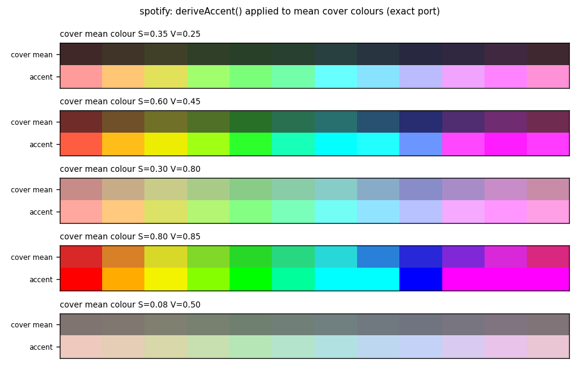

# cyd-lab



Three PlatformIO firmware projects for the ESP32 "Cheap Yellow Display" (ESP32-2432S028: ESP32-WROOM, 2.8" 320x240 ILI9341, XPT2046 resistive touch, RGB LED, speaker output on GPIO26). The figure above is the cover-art accent colour function from `spotify`, run through an exact Python port of the firmware arithmetic.

| Project | What it does | Connectivity | Extra software |
|---|---|---|---|
| [deskmate](deskmate/) | NTP clock, current weather (Open-Meteo), touch Pomodoro timer | Wi-Fi (WiFiManager captive setup) | none |
| [spectrum](spectrum/) | Bluetooth A2DP speaker with a 32-band FFT spectrum and track metadata | Bluetooth Classic, no Wi-Fi | none |
| [spotify](spotify/) | Spotify now-playing screen (cover, title, progress) with touch prev / play-pause / next | USB serial to a host computer, no Wi-Fi | Python bridge on the host (`spotify/tools/`) |

## Build and flash

Each folder is an independent [PlatformIO](https://platformio.org/) project with one environment, `cyd`.

```sh
cd deskmate            # or spectrum, spotify
pio run -e cyd -t upload --upload-port <SERIAL_PORT>
pio device monitor --port <SERIAL_PORT>
```

`<SERIAL_PORT>` is something like `/dev/cu.usbserial-XXXX` (macOS), `/dev/ttyUSB0` (Linux) or `COMx` (Windows). `upload_speed` is 460800 because 921600 was unreliable on the board used here.

## Display and pins

The display configuration is passed to TFT_eSPI through `build_flags` in each `platformio.ini`, so the library's `User_Setup.h` stays untouched. The driver is `ILI9341_2_DRIVER` (from the witnessmenow CYD community guide), not `ILI9341_DRIVER`. The display sits on HSPI (MISO 12, MOSI 13, SCLK 14, CS 15, DC 2, backlight 21, no reset); touch is on a separate VSPI bus (CLK 25, MOSI 32, MISO 39, CS 33, IRQ 36); the RGB LED is on GPIO 4 / 16 / 17, active low.

CYD boards come in several revisions with different panels, touch or USB chips. If colours look inverted, toggle `tft.invertDisplay()`; `spotify` enables inversion, the other two don't.

The plots in the project READMEs come from [`docs/make_figures.py`](docs/make_figures.py), which parses constants out of the firmware sources and ports the arithmetic to Python (`python3 docs/make_figures.py`, needs numpy and matplotlib).

## Limitations

- `platform = espressif32` is not pinned. `spectrum` uses the Arduino-ESP32 2.x LEDC API (`ledcSetup` / `ledcAttachPin`), removed in 3.x.
- Hobby projects, each tested on one board, no automated tests.
- On-screen strings were translated from Italian for this public copy. These exact sources have not been recompiled and flashed since.

## License

MIT, see [LICENSE](LICENSE). Libraries are downloaded by PlatformIO at build time and keep their own licenses. `kosme/arduinoFFT`, used by `spectrum`, is GPL-3.0, which matters if you distribute compiled binaries of that project.
