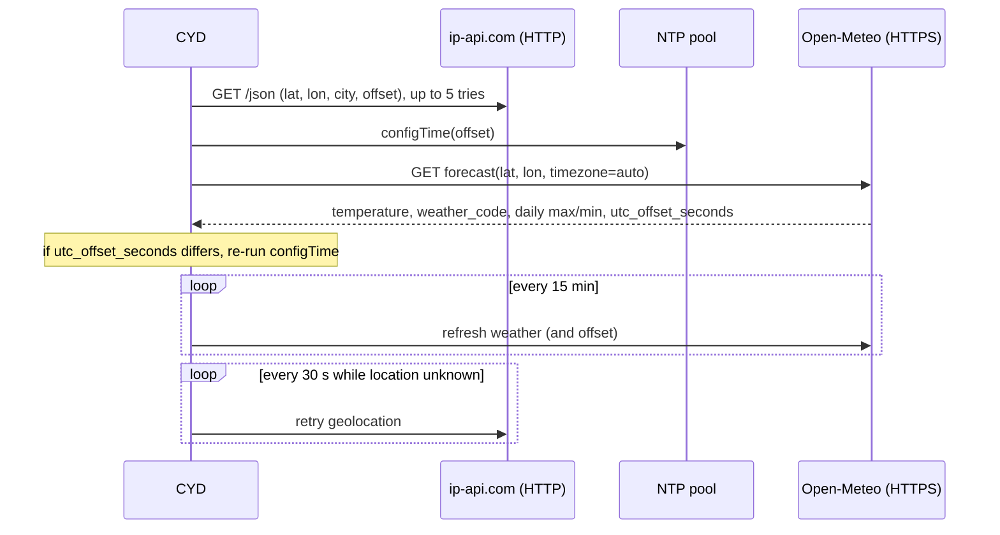
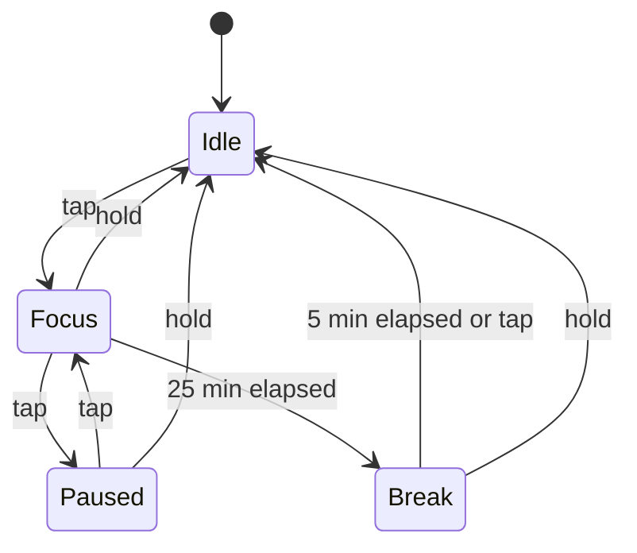

# deskmate: clock, weather and Pomodoro

A desk display for the CYD: a large NTP-synced clock with seconds, the date, current weather with
today's high and low from Open-Meteo, and a 25/5 minute Pomodoro timer you drive by touch.
Location and UTC offset are found automatically from the public IP, so nothing is hard-coded
and no API key is needed.

## Hardware

- ESP32-2432S028 ("Cheap Yellow Display").
- A 2.4 GHz Wi-Fi network with internet access.

## Build and flash

```sh
cd deskmate
pio run -e cyd -t upload --upload-port <SERIAL_PORT>
pio device monitor --port <SERIAL_PORT>      # 115200 baud
```

On first boot the board opens a Wi-Fi access point named `CYD-Setup` (WiFiManager). Join it from a
phone, pick your network and enter the password; credentials are stored in the ESP32's NVS and
reused afterwards. The portal times out after 180 s and the firmware continues without network; if
Wi-Fi comes up later, the 30 s geolocation retry in `loop()` starts the clock and the weather.

## Usage

| Touch | Effect |
|---|---|
| Tap | idle: start a 25 min focus block. Focus: pause. Paused: resume. Break: back to idle. |
| Hold > 1.2 s | reset to idle |

The RGB LED mirrors the state: green idle, red focus, off paused, blue break. When a phase ends the
timer card flashes three times and the next phase starts automatically (focus, then break, then idle).

## Architecture





## Design decisions

- **Two sources for the UTC offset.** ip-api gives a first offset so NTP time is usable immediately.
  Open-Meteo, called with `timezone=auto`, returns `utc_offset_seconds` for the coordinates and wins
  when the two disagree. Because the weather refresh runs every 15 minutes, a daylight-saving change is
  picked up within at most 15 minutes, without shipping a POSIX TZ table for every region.
- **Timer from `millis()`, not wall-clock time.** A phase stores an absolute end time
  $t_\text{end} = t_\text{start} + T$; the remaining time is $\max(0, t_\text{end} - t)$, and pausing freezes
  that value. NTP corrections never make the timer jump.
- **Cached field redraws.** Every text field keeps the last string it drew and is cleared and redrawn
  only when the string changes. The loop refreshes at 4 Hz, which keeps the seconds smooth with very
  little SPI traffic and no full-screen flicker.
- **Touch as a single button.** The touch panel is used only as "pressed / not pressed" with press
  duration, so it needs no calibration.

## Limitations

- Geolocation uses ip-api.com over plain HTTP (its free tier has no HTTPS). With a VPN the city and
  weather follow the VPN exit.
- Open-Meteo is called over HTTPS with `setInsecure()`: the connection is encrypted but the server
  certificate is not validated.
- Weather codes are reduced to nine coarse labels, and the screen uses the TFT_eSPI built-in fonts
  (ASCII only).
- Focus and break lengths are compile-time constants (`FOCUS_MS`, `BREAK_MS`).

## License

MIT, see [LICENSE](../LICENSE). Libraries (TFT_eSPI, XPT2046_Touchscreen, WiFiManager, ArduinoJson)
are downloaded by PlatformIO at build time under their own licenses.
