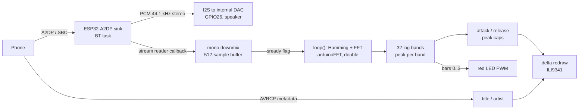

# spectrum: Bluetooth speaker with a live FFT spectrum

The CYD shows up as a Bluetooth speaker called `CYD-Music`. Audio streamed from a phone over
A2DP plays through the board's speaker output, and the same PCM stream feeds a 512-point FFT
drawn as 32 log-spaced bars with falling peak caps. Track title and artist come over AVRCP.
The red LED glows with the bass. No Wi-Fi is used.

## Hardware

- ESP32-2432S028 ("Cheap Yellow Display").
- A small speaker on the board's speaker connector (driven from GPIO26, the ESP32's internal DAC).
- A phone or computer with Bluetooth audio.

## Build and flash

```sh
cd spectrum
pio run -e cyd -t upload --upload-port <SERIAL_PORT>
pio device monitor --port <SERIAL_PORT>      # 115200 baud
```

Then pair with `CYD-Music` and play something. The wait screen switches to the visualizer on connect.

`board_build.partitions = huge_app.csv` is required: Bluetooth Classic plus the display stack
does not fit in the default 1.3 MB app partition. The image therefore has no OTA slot.

## Architecture



The Bluetooth callback and the render loop share one 512-sample buffer and a `volatile bool sready`.
The callback fills the buffer only while `sready == false`; once full it raises the flag and drops
incoming chunks until `loop()` has copied the samples out. No locks, no queue, and audio playback
is never blocked by rendering (`set_stream_reader(..., true)` keeps the I2S output running).
The cost is that the visualizer looks at a subsampled set of windows, not every sample.

## Signal processing

**Downmix.** Each stereo frame $(L, R)$ of int16 becomes $x[n] = (L + R) \gg 1$.

**Window and transform.** With $N = 512$ and $f_s = 44100$ Hz:

$$\Delta f = \frac{f_s}{N} \approx 86.13\ \text{Hz}, \qquad T_\text{frame} = \frac{N}{f_s} \approx 11.6\ \text{ms}$$

The mean is removed (`dcRemoval`), a Hamming window is applied,

$$w[n] = 0.54 - 0.46 \cos\!\left(\frac{2\pi n}{N-1}\right),$$

and the magnitude $|X[k]|$ is computed for $k = 0 \dots N/2 - 1$.

**Log band edges.** Bar $b$ spans bins $[e_b, e_{b+1})$ with

$$e_i = \left\lfloor k_\text{lo} \left(\frac{k_\text{hi}}{k_\text{lo}}\right)^{i/32} \right\rfloor,\quad k_\text{lo} = 2,\ k_\text{hi} = 255,$$

then forced strictly increasing ($e_i \leftarrow e_{i-1} + 1$ when the floor collides). Computed from
the firmware constants by [`docs/make_figures.py`](../docs/make_figures.py):

```
edges = [2, 3, 4, ..., 15, 16, 19, 22, 26, 30, 35, 41, 48, 56, 65, 75, 88, 102, 119, 139, 161, 188, 219, 255]
bins per bar = 1 x 14, then 3, 3, 4, 4, 5, 6, 7, 8, 9, 10, 13, 14, 17, 20, 22, 27, 31, 36
range = 172 Hz .. 21.96 kHz
```


The forced increment means the first 14 bars are single 86 Hz bins, so the low end is effectively
linear and nothing below about 172 Hz is shown. That is the price of $N = 512$; a larger $N$ would
resolve bass better but halve the update rate and double the RAM for the `double` buffers.

**Band value and height.** Each bar takes the peak (not the mean) magnitude in its band, so a
single strong partial lights the bar even in wide high-frequency bands:

$$m_b = \max_{k \in [e_b, e_{b+1})} |X[k]|, \qquad
h_b = \operatorname{clamp}\!\left(\frac{\log_{10}(m_b + 1) - 2.3}{6.2 - 2.3} \cdot 190,\ 0,\ 190\right)$$

A 3.9-decade (78 dB) window of magnitude maps onto the 190 px drawing area. `LOG_FLOOR` and
`LOG_CEIL` are the tuning knobs.


**Ballistics.** Instant attack, linear release of 7 px per frame for the bar and 1 px per frame for
the peak cap:

$$H_b[t] = \begin{cases} h_b[t] & h_b[t] \ge H_b[t-1] \\ \max(h_b[t],\ H_b[t-1] - 7) & \text{otherwise} \end{cases}$$


**Bass LED.** The mean height of bars 0 to 3 (about 172 to 517 Hz) is scaled to an 8-bit LEDC duty
on the red LED, inverted because the LED is active low.

## Rendering

Bars are redrawn as deltas: only the strip between the old and new height is filled, and a full
column repaint happens only when the bar crosses a colour threshold (30 / 58 / 82 % of full height).
This keeps SPI traffic small enough to avoid flicker without a frame buffer, which the ESP32 could not
spare next to the Bluetooth stack (a 320x190 16-bit sprite would be about 120 KB).

## Limitations

- The ESP32 internal DAC is 8-bit, so audio quality is that of a toy speaker, not a hi-fi sink.
- The FFT uses `double`. The ESP32 FPU is single-precision, so double maths is emulated in software;
  switching to `float` is an obvious, untested optimisation.
- `ESP32-A2DP` is pulled from its Git repository without a version pin. The I2S setup goes through
  `set_i2s_config` with the legacy ESP-IDF `i2s_config_t`; a future release of the library may
  require changes here.
- `ledcSetup` / `ledcAttachPin` require Arduino-ESP32 2.x.
- Track titles are truncated to 30 characters and drawn with the built-in fonts (no UTF-8 glyphs).

## License

MIT, see [LICENSE](../LICENSE). `kosme/arduinoFFT` is GPL-3.0 and `ESP32-A2DP` is Apache-2.0;
both are downloaded at build time, not vendored.
