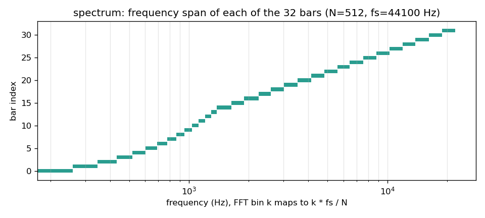
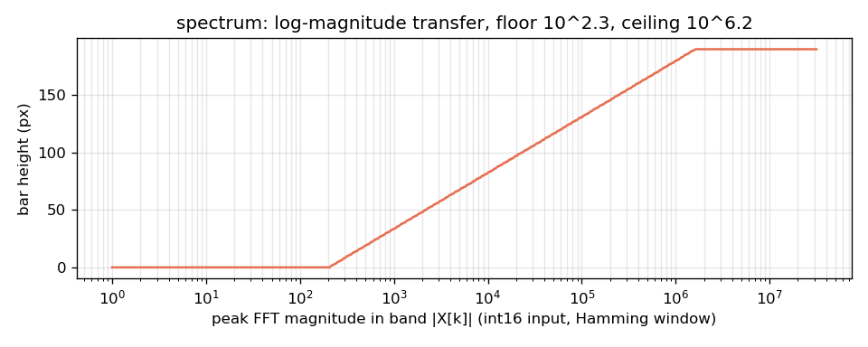
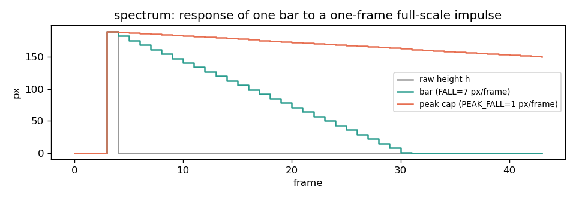

# spectrum



The CYD shows up as a Bluetooth speaker called `CYD-Music`. A2DP audio from a phone plays through the board's speaker output, and the same PCM stream feeds a 512-point FFT drawn as 32 log-spaced bars with falling peak caps; title and artist come over AVRCP and the red LED follows the bass. Because $N = 512$, the first 14 bars are single 86 Hz bins and nothing below about 172 Hz is shown.

## Build and flash

Needs an ESP32-2432S028, a small speaker on the speaker connector (GPIO26, the ESP32's internal DAC), and a phone or computer with Bluetooth audio. No Wi-Fi.

```sh
cd spectrum
pio run -e cyd -t upload --upload-port <SERIAL_PORT>
pio device monitor --port <SERIAL_PORT>      # 115200 baud
```

Pair with `CYD-Music` and play something; the wait screen switches to the visualizer on connect. `board_build.partitions = huge_app.csv` is required because Bluetooth Classic plus the display stack does not fit in the default 1.3 MB app partition, so there is no OTA slot.

## Audio path

The ESP32-A2DP sink sends 44.1 kHz stereo PCM to I2S and the internal DAC, and a stream reader callback downmixes each frame to $x[n] = (L + R) \gg 1$ into a 512-sample buffer. Callback and render loop share that buffer through a `volatile bool sready`: the callback fills it only while `sready == false`, raises the flag when full, and drops chunks until `loop()` has copied the samples out. There are no locks or queues, and `set_stream_reader(..., true)` keeps I2S running, so rendering never blocks playback. The visualizer sees a subsample of the windows, not every sample.

## Spectrum

With $N = 512$ and $f_s = 44100$ Hz, $\Delta f \approx 86.13$ Hz and a frame is about 11.6 ms. The mean is removed, a Hamming window $w[n] = 0.54 - 0.46 \cos(2\pi n/(N-1))$ applied, and $|X[k]|$ computed for $k = 0 \dots N/2 - 1$. Bar $b$ spans bins $[e_b, e_{b+1})$ with

$$e_i = \left\lfloor k_\text{lo} \left(\frac{k_\text{hi}}{k_\text{lo}}\right)^{i/32} \right\rfloor,\quad k_\text{lo} = 2,\ k_\text{hi} = 255,$$

forced strictly increasing where the floor collides. From the firmware constants ([`docs/make_figures.py`](../docs/make_figures.py)):

```
edges = [2, 3, 4, ..., 15, 16, 19, 22, 26, 30, 35, 41, 48, 56, 65, 75, 88, 102, 119, 139, 161, 188, 219, 255]
bins per bar = 1 x 14, then 3, 3, 4, 4, 5, 6, 7, 8, 9, 10, 13, 14, 17, 20, 22, 27, 31, 36
range = 172 Hz .. 21.96 kHz
```

The forced increment makes the low end effectively linear. A larger $N$ would resolve bass better but halve the update rate and double the RAM for the `double` buffers.

Each bar takes the peak magnitude in its band, so one strong partial lights a wide high-frequency band, and maps 3.9 decades (78 dB) onto 190 px:

$$m_b = \max_{k \in [e_b, e_{b+1})} |X[k]|, \qquad
h_b = \operatorname{clamp}\!\left(\frac{\log_{10}(m_b + 1) - 2.3}{6.2 - 2.3} \cdot 190,\ 0,\ 190\right)$$

`LOG_FLOOR` and `LOG_CEIL` are the tuning knobs.



Attack is instant and release linear, 7 px per frame for the bar and 1 px per frame for the peak cap:

$$H_b[t] = \begin{cases} h_b[t] & h_b[t] \ge H_b[t-1] \\ \max(h_b[t],\ H_b[t-1] - 7) & \text{otherwise} \end{cases}$$



The mean height of bars 0 to 3 (about 172 to 517 Hz) sets an 8-bit LEDC duty on the red LED, inverted because it is active low.

Bars are redrawn as deltas: only the strip between old and new height is filled, with a full column repaint only when a bar crosses a colour threshold (30 / 58 / 82 % of full height). That avoids flicker without a frame buffer, which the ESP32 couldn't spare next to the Bluetooth stack (a 320x190 16-bit sprite would be about 120 KB).

## Limitations

- The internal DAC is 8-bit; toy-speaker quality.
- The FFT uses `double`, emulated in software on the single-precision FPU. Switching to `float` is untested.
- `ESP32-A2DP` is pulled from Git without a version pin, and I2S goes through `set_i2s_config` with the legacy ESP-IDF `i2s_config_t`. A future release may break this.
- `ledcSetup` / `ledcAttachPin` require Arduino-ESP32 2.x.
- Titles truncated to 30 characters, built-in fonts, no UTF-8.

## License

MIT, see [LICENSE](../LICENSE). `kosme/arduinoFFT` is GPL-3.0 and `ESP32-A2DP` is Apache-2.0; both are downloaded at build time, not vendored.
