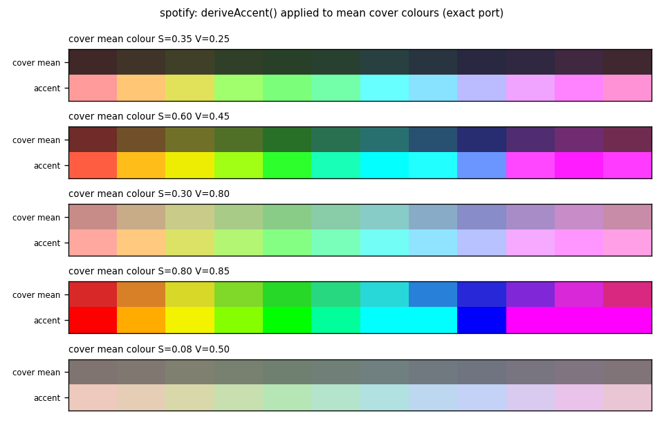

# spotify



A wired now-playing display and remote for Spotify on the CYD: cover art with a glow frame, title, artist, album, a progress bar at about 30 fps, and touch buttons for previous, play/pause and next. The board has no Wi-Fi code. A Python bridge on the host talks to the Spotify Web API and pushes text and pre-sized JPEGs over USB serial at 460800 baud, and the accent colour is computed on the board while the cover decodes.

## Setup

You need the CYD on a USB cable to a computer, Python 3 with `pyserial` (and `Pillow`, see below), and an app from the [Spotify developer dashboard](https://developer.spotify.com/dashboard). Spotify only allows playback control for Premium accounts. Audio keeps playing wherever Spotify is playing.

```sh
cd spotify
pio run -e cyd -t upload --upload-port <SERIAL_PORT>
```

The splash reads "connect to host..." until the first track arrives. Register `http://127.0.0.1:8888/callback` as the app's redirect URI, then get a refresh token once (it opens the browser, listens on `127.0.0.1:8888` and prints the token; scopes `user-read-currently-playing user-read-playback-state user-modify-playback-state`):

```sh
CLIENT_ID=<id> CLIENT_SECRET=<secret> python3 tools/spotify_auth.py
```

Give the bridge `SPOTIFY_CLIENT_ID`, `SPOTIFY_CLIENT_SECRET` and `SPOTIFY_REFRESH_TOKEN` as environment variables, or copy `tools/spotify_credentials.example.json` to `tools/spotify_credentials.json` (gitignored) and fill it in. Then:

```sh
pip install pyserial pillow
python3 tools/spotify_bridge.py [<SERIAL_PORT>]
```

Without an argument it looks for `/dev/cu.usbserial-*`, `/dev/cu.wchusbserial*` and `/dev/cu.SLAB_USBtoUART*` (macOS); on Linux or Windows pass the port. It reconnects by itself when the cable is unplugged or the board reboots.

## Serial protocol

Lines end with `\n` and fields are separated by `0x1F` (`US`), which the bridge strips from titles.

| Direction | Message | Meaning |
|---|---|---|
| host to CYD | `T US title US artist US album US duration_ms US progress_ms US playing` | new track, full redraw |
| host to CYD | `P US progress_ms US playing` | progress / play-state resync |
| host to CYD | `J US len` then `len` raw bytes | cover art, baseline JPEG |
| CYD to host | `N`, `B`, `S` | next, previous, toggle play/pause |
| CYD to host | `#...` | debug; `#ready` after boot makes the bridge resend everything |

After a `J` line the firmware reads exactly `len` bytes (at most 220 000, 4 s inactivity timeout) before going back to line parsing. A cover takes $t \approx 10 \cdot \text{len} / 460800$ s with 8N1 framing, so the bridge resizes art to the 148x148 cover box with Pillow at JPEG quality 85. Without Pillow the original (typically 300x300) is sent and drawn unscaled, overflowing the box.

The bridge polls `/v1/me/player/currently-playing` every 0.5 s, and every 0.15 s for 1.5 s after next/previous or 0.8 s after a toggle. Between polls the board extrapolates $p(t) = p_0 + (t - t_0)$ while playing, clamped to $[0, d]$, and redraws the bar every 33 ms into an off-screen 320x22 sprite pushed in one go. Play/pause flips the icon immediately and the next poll confirms.

## Accent colour

The TJpg_Decoder output callback sums the RGB565 channels of every decoded block, giving the mean colour $\bar R = 8 \sum R_5 / n$, $\bar G = 4 \sum G_6 / n$, $\bar B = 8 \sum B_5 / n$. `deriveAccent()` pushes each channel away from the grey mean $\mu$ by 1.8, $c' = \mu + 1.8\,(c - \mu)$, then rescales to a fixed luma of 210 with integer BT.601 weights so dark covers stay readable on black and bright ones don't burn out:

$$Y = \frac{77 R' + 150 G' + 29 B'}{256}, \qquad c'' = \operatorname{clamp}\!\left(\frac{210}{Y}\, c',\ 0,\ 255\right)$$

The figure at the top is the Python port of that function ([`docs/make_figures.py`](../docs/make_figures.py)) over a sweep of mean colours, RGB565 quantisation included. Near-grey covers give pastel accents and saturated covers clip to full hues. The glow is four rounded rectangles in the accent colour at 6 to 24 % brightness.

## Gotchas and limitations

- The firmware calls `tft.invertDisplay(true)`, unlike the other two projects. If colours look like a negative, remove it.
- Touch uses a fixed raw range of 300 to 3800 on both axes; only the bottom 40 px react, in three zones.
- Opening the port resets the ESP32 (DTR/RTS). The bridge waits 1.6 s and flushes input first, and `#ready` covers later resets.
- `monitor_speed = 460800`; a serial monitor and the bridge can't hold the port at the same time.
- Tethered: needs a computer running the bridge.
- GFX FreeFonts, ASCII only; non-Latin titles won't render.
- Tracks only (`additional_types=track`), no podcast episodes.

## License

MIT, see [LICENSE](../LICENSE). TFT_eSPI, TJpg_Decoder and XPT2046_Touchscreen are downloaded at build time under their own licenses.
