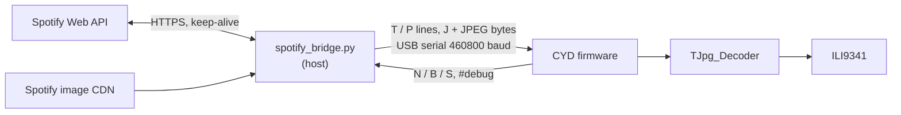

# spotify: wired now-playing display and remote

The CYD shows what your Spotify account is playing: cover art with a glow frame, title, artist, album
and a progress bar that moves smoothly at about 30 fps. Three touch buttons send previous,
play/pause and next. The accent colour of the artist name, progress bar and glow is derived from the
cover art.

The board has no Wi-Fi code at all. A small Python bridge on the host computer talks to the Spotify
Web API and pushes text and pre-sized JPEG cover art to the CYD over the USB serial cable; the CYD
sends button presses back. Audio keeps playing wherever Spotify is playing.

## Hardware and accounts

- ESP32-2432S028 ("Cheap Yellow Display") on a USB cable to a computer running the bridge.
- Python 3 with `pyserial`; `Pillow` is strongly recommended (see below).
- A Spotify account and an app from the [Spotify developer dashboard](https://developer.spotify.com/dashboard).
  Spotify only allows playback control (play, pause, next, previous) for Premium accounts.

## Setup

1. **Flash the firmware.**
   ```sh
   cd spotify
   pio run -e cyd -t upload --upload-port <SERIAL_PORT>
   ```
   The splash screen reads "connect to host..." until the bridge sends the first track.

2. **Create a Spotify app** and register the redirect URI `http://127.0.0.1:8888/callback`.

3. **Get a refresh token** (once). This opens the browser, listens on `127.0.0.1:8888` and prints the token:
   ```sh
   CLIENT_ID=<id> CLIENT_SECRET=<secret> python3 tools/spotify_auth.py
   ```
   Requested scopes: `user-read-currently-playing user-read-playback-state user-modify-playback-state`.

4. **Give the bridge its credentials**, either as environment variables
   (`SPOTIFY_CLIENT_ID`, `SPOTIFY_CLIENT_SECRET`, `SPOTIFY_REFRESH_TOKEN`) or by copying
   `tools/spotify_credentials.example.json` to `tools/spotify_credentials.json` (gitignored) and filling it in.

5. **Run the bridge.**
   ```sh
   pip install pyserial pillow
   python3 tools/spotify_bridge.py [<SERIAL_PORT>]
   ```
   Without an argument it auto-detects `/dev/cu.usbserial-*`, `/dev/cu.wchusbserial*` and
   `/dev/cu.SLAB_USBtoUART*` (macOS names). On Linux or Windows pass the port explicitly.
   It reconnects on its own when the cable is unplugged or the board reboots.

## Architecture



### Serial protocol

Lines end with `\n`; fields are separated by the ASCII unit separator `0x1F` (shown as `US`), which the
bridge strips from titles so it can never appear inside a field.

| Direction | Message | Meaning |
|---|---|---|
| host to CYD | `T US title US artist US album US duration_ms US progress_ms US playing` | new track, full redraw |
| host to CYD | `P US progress_ms US playing` | progress / play-state resync |
| host to CYD | `J US len` then `len` raw bytes | cover art, baseline JPEG |
| CYD to host | `N`, `B`, `S` | next, previous, toggle play/pause |
| CYD to host | `#...` | debug; `#ready` after boot makes the bridge resend everything |

The JPEG is length-prefixed binary inside a line protocol: after the `J` line the firmware reads
exactly `len` bytes (at most 220 000, 4 s inactivity timeout) before returning to line parsing.

### Timing

- The bridge polls `/v1/me/player/currently-playing` every 0.5 s, every 0.15 s for 1.5 s after
  next/previous and for 0.8 s after a toggle, so a tap shows up on screen quickly.
- Between resyncs the CYD extrapolates locally,
  $p(t) = p_0 + (t - t_0)$ while playing, clamped to $[0, d]$, and redraws the bar every 33 ms into an
  off-screen 320x22 sprite that is pushed in one go (no flicker).
- Play/pause is optimistic: the icon flips immediately on touch, then the next poll confirms.
- Cover transfer time is $t \approx 10 \cdot \text{len} / 460800$ s (8N1 framing). The bridge resizes
  art to the 148x148 cover box with Pillow (JPEG quality 85) so it stays small; without Pillow the
  original (typically 300x300) from Spotify is sent and drawn unscaled, which overflows the cover box.

## Accent colour from the cover

While the JPEG is decoded, the TJpg_Decoder output callback also accumulates the RGB565 channel sums
of every decoded block. The mean colour in 8-bit terms is

$$\bar R = 8 \cdot \frac{\sum R_5}{n}, \quad \bar G = 4 \cdot \frac{\sum G_6}{n}, \quad \bar B = 8 \cdot \frac{\sum B_5}{n}$$

`deriveAccent()` then (1) pushes each channel away from the grey mean $\mu = (\bar R + \bar G + \bar B)/3$
by a factor 1.8, a cheap saturation boost:

$$c' = \mu + 1.8\,(c - \mu)$$

and (2) rescales to a fixed luma of 210 using integer BT.601 weights, so dark covers still give a
readable accent on black and bright covers do not burn out:

$$Y = \frac{77 R' + 150 G' + 29 B'}{256}, \qquad c'' = \operatorname{clamp}\!\left(\frac{210}{Y}\, c',\ 0,\ 255\right)$$

The figure below is the exact Python port of that function ([`docs/make_figures.py`](../docs/make_figures.py))
applied to a sweep of mean colours, including the RGB565 quantisation:


Near-grey covers produce pastel accents (little chroma to amplify); saturated covers clip to fully
saturated hues. The glow around the cover is four rounded rectangles in the accent colour at 6 to 24 %
brightness.

## Gotchas

- The firmware calls `tft.invertDisplay(true)`; the other two projects in this repo do not. If colours
  look like a negative on your board, remove that call.
- Touch mapping uses a fixed raw range of 300 to 3800 on both axes; only the bottom 40 px (the button
  row) react, split into three zones.
- Opening the serial port resets the ESP32 (DTR/RTS auto-reset). The bridge waits 1.6 s and flushes
  input before talking, and the `#ready` handshake covers later resets.
- `monitor_speed = 460800` matches the firmware; a serial monitor and the bridge cannot hold the port at the same time.

## Limitations

- Needs a computer running the bridge; it is a tethered display, not a standalone device.
- Text is drawn with GFX FreeFonts (ASCII). Non-Latin titles will not render correctly.
- Only tracks (`additional_types=track`); podcast episodes are not shown.

## License

MIT, see [LICENSE](../LICENSE). TFT_eSPI, TJpg_Decoder and XPT2046_Touchscreen are downloaded at
build time under their own licenses.
